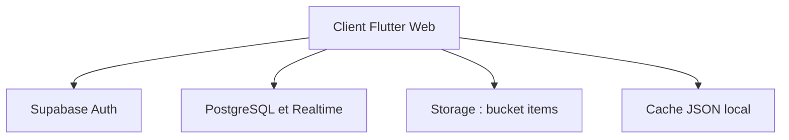

# LostAndFound

Prototype universitaire Flutter/Supabase pour signaler des objets perdus ou trouvés et échanger des commentaires. Réalisé à la FST Settat, Université Hassan 1er, dans le module Programmation Mobile (2024–2025).

## Fonctionnement

- Inscription et connexion par email/mot de passe avec Supabase Auth.
- Déclaration : nom, description, catégorie, lieu et photo facultative.
- Liste en temps réel des 20 objets les plus récents, filtrée côté client par type et nom.
- Commentaires en temps réel et graphique des catégories de ces objets.
- Écriture d'un cache JSON local ; l'interface ne propose pas encore de consultation hors ligne.

Le sélecteur de photo actuel utilise `dart:html` : le client cible le **Web** à ce stade. Les dossiers Android/iOS ne prouvent pas la compatibilité mobile. Aucune démo publique vérifiée n'est disponible.

## Architecture



Le code utilise des widgets avec état et un service Supabase. Les tables attendues sont `items`, `user_reports` et `comments`.

## Installation

Version utilisée par la CI : **Flutter 3.29.3 / Dart 3.7**.

```bash
git clone https://github.com/abdel-saw/LostAndFoundApp.git
cd LostAndFoundApp/lost_and_found_app
flutter pub get
flutter run -d chrome \
  --dart-define=SUPABASE_URL=https://VOTRE-PROJET.supabase.co \
  --dart-define=SUPABASE_ANON_KEY=VOTRE-CLE-PUBLIQUE
```

Les paramètres sont lus avec `String.fromEnvironment`. Un fichier `.env` n'est pas chargé. L'application échoue avec un message explicite si la configuration manque.

La clé anon/publique est visible dans une application compilée. N'utilisez jamais de clé `service_role` ou secrète côté client. Les règles RLS et Storage doivent contrôler les accès.

**Limite de reproductibilité :** les migrations SQL et les politiques du projet Supabase d'origine ne sont pas encore versionnées. Cette commande ne crée pas la base. Utilisez une base de développement compatible ; le prochain travail est de fournir un schéma et des politiques testés avant toute publication.

## Vérification

```bash
flutter analyze --no-fatal-infos
flutter test
flutter build web --release \
  --dart-define=SUPABASE_URL=https://example.supabase.co \
  --dart-define=SUPABASE_ANON_KEY=fixture-anon-key
```

Les tests couvrent les écritures de déclaration via le vrai client Supabase avec un transport HTTP simulé, le cache JSON, la configuration et les interactions de connexion sans réseau. La compilation Web utilise une configuration fictive et ne valide pas un service Supabase réel. Les erreurs et avertissements d'analyse bloquent la CI ; les remarques informatives restent visibles.

## Prochaines étapes

1. Versionner le schéma SQL, les politiques RLS/Storage et leurs tests.
2. Créer l'objet et son rapport dans une même transaction SQL. La correction du doublon conserve actuellement deux requêtes : un échec de la seconde peut laisser un objet sans rapport.
3. Vérifier inscription, connexion, photo, déclaration, commentaires et Realtime sur une base de développement.
4. Publier le client Web statique avec des données fictives après cette validation.

Les notifications, profils de contact, géolocalisation, recherche par lieu et pagination au-delà des 20 objets ne sont pas implémentés.

## Auteur

SAWADOGO S. Abdel — FST Settat.
