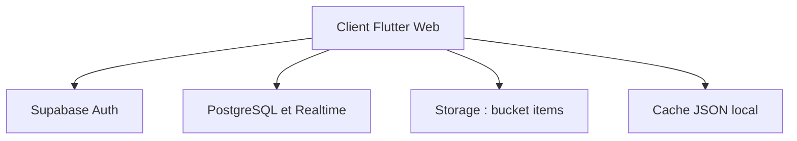

# LostAndFound

Prototype universitaire Flutter/Supabase pour signaler des objets perdus ou trouvés et échanger des commentaires. Réalisé à la FST Settat, Université Hassan 1er, dans le module Programmation Mobile (2024–2025).

## Fonctionnement

- Inscription et connexion par email/mot de passe avec Supabase Auth.
- Déclaration : nom, description, catégorie, lieu et photo facultative.
- Liste en temps réel des 20 objets les plus récents, filtrée côté client par type et nom.
- Commentaires en temps réel et graphique des catégories de ces objets.
- Écriture d'un cache JSON local ; l'interface ne propose pas encore de consultation hors ligne.

Le sélecteur de photo actuel utilise `dart:html` : le client cible le **Web** à ce stade. Les dossiers Android/iOS ne prouvent pas la compatibilité mobile. Aucune démo publique vérifiée n'est disponible.

## Architecture



Le code utilise des widgets avec état et un service Supabase. Les tables attendues sont `items`, `user_reports` et `comments`.

## Installation

Version utilisée par la CI : **Flutter 3.29.3 / Dart 3.7**.

```bash
git clone https://github.com/abdel-saw/LostAndFoundApp.git
cd LostAndFoundApp/lost_and_found_app
flutter pub get
flutter run -d chrome \
  --dart-define=SUPABASE_URL=https://VOTRE-PROJET.supabase.co \
  --dart-define=SUPABASE_ANON_KEY=VOTRE-CLE-PUBLIQUE
```

Les paramètres sont lus avec `String.fromEnvironment`. Un fichier `.env` n'est pas chargé. L'application échoue avec un message explicite si la configuration manque.

La clé anon/publique est visible dans une application compilée. N'utilisez jamais de clé `service_role` ou secrète côté client. Les règles RLS et Storage doivent contrôler les accès.

Le schéma et les politiques sont versionnés dans `supabase/migrations/`. Depuis la racine du dépôt, lancez `supabase start` (Docker et CLI Supabase 3.3.0), puis utilisez l'URL et la clé anon locales affichées. Configurez un port Web fixe avec `flutter run -d chrome --web-port=3000` et les deux `--dart-define`.

Consultez [la configuration de la base](docs/DATABASE.md) pour les droits, les tests et la procédure sur un **nouveau** projet Supabase. Cette migration constitue une nouvelle base, pas une conversion du projet historique.

## Vérification

```bash
flutter analyze --no-fatal-infos
flutter test
flutter build web --release \
  --dart-define=SUPABASE_URL=https://example.supabase.co \
  --dart-define=SUPABASE_ANON_KEY=fixture-anon-key
```

Les tests Flutter couvrent l'appel RPC avec un transport HTTP simulé, le cache JSON, la configuration et les interactions de connexion sans réseau. La CI Supabase exécute également les migrations, les tests SQL/RLS et des appels Auth/REST/Storage contre une pile locale jetable. La compilation Web utilise une configuration fictive et ne valide pas un service Supabase réel. Les erreurs et avertissements d'analyse bloquent la CI ; les remarques informatives restent visibles.

## Prochaines étapes

1. Vérifier le parcours complet dans un navigateur : connexion, photo, déclaration, commentaires et Realtime.
2. Préparer des données fictives et une configuration hébergée.
3. Publier le client Web statique après cette validation.

La création utilise maintenant `report_item` : objet et rapport sont enregistrés dans une même transaction. L'identité et l'heure sont fixées côté serveur. Les tests SQL provoquent un échec de la seconde écriture pour vérifier le rollback.

Les notifications, profils de contact, géolocalisation, recherche par lieu et pagination au-delà des 20 objets ne sont pas implémentés.

## Auteur

SAWADOGO S. Abdel — FST Settat.
